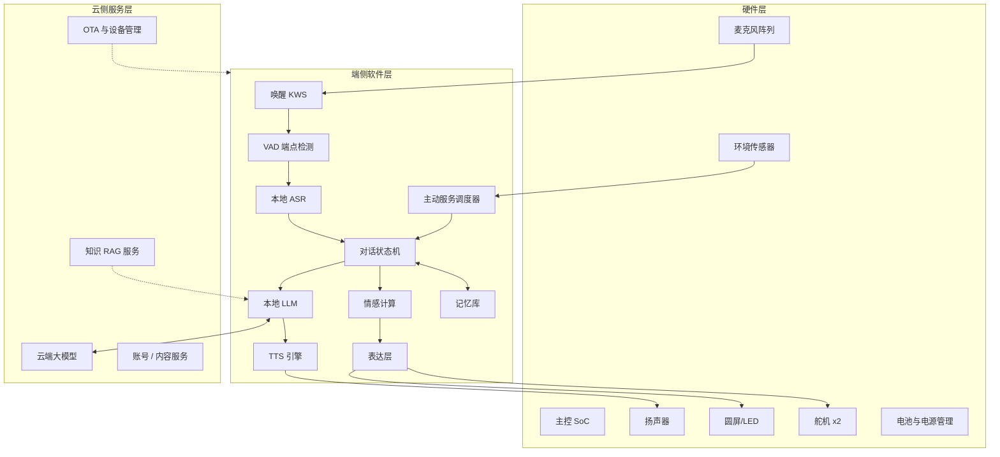
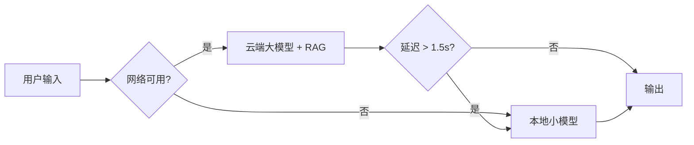
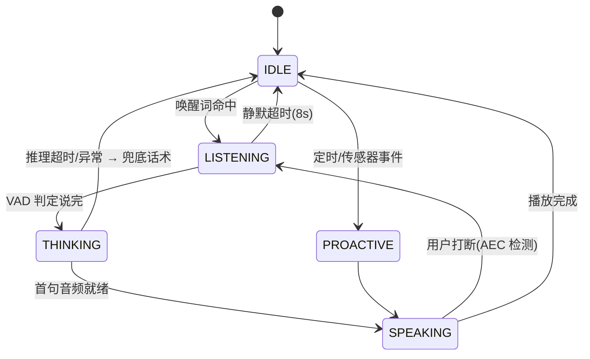
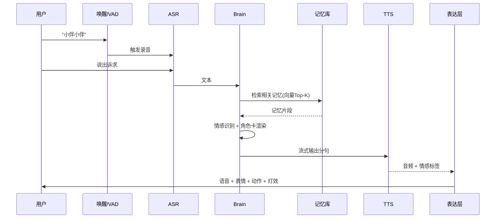
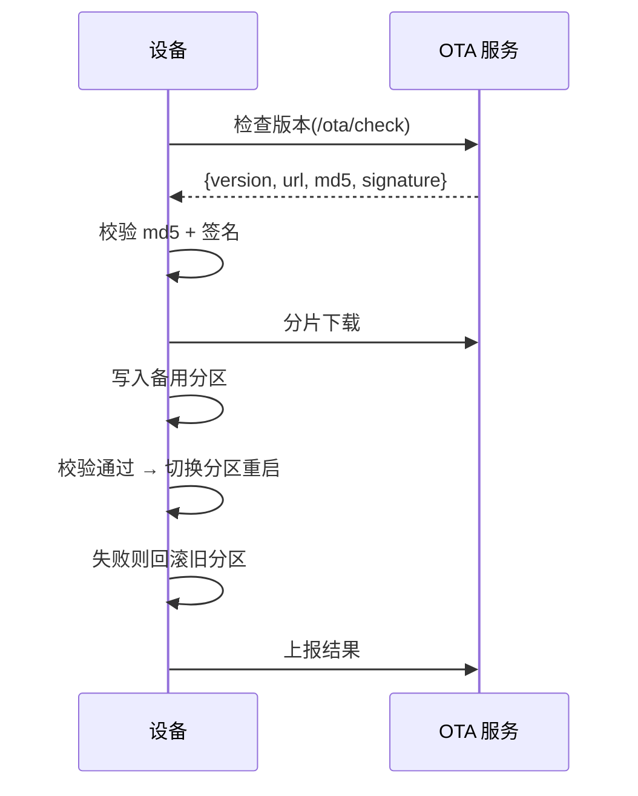

# AI 陪伴桌面机器人 · 技术方案设计文档

| 项目名称 | AI 陪伴桌面机器人（代号：小伴 / Buddy） |
| --- | --- |
| 文档版本 | v0.1（草案） |
| 文档状态 | 评审中 |
| 编写日期 | 2026-10-19 |
| 读者对象 | 开发者本人（单人全栈 + AI 结对） |
| 文档定位 | 指导从软件原型到可量产硬件的技术实施路线 |

---

## 1. 文档说明

### 1.1 目的

本文档定义 AI 陪伴桌面机器人的技术架构、模块职责、关键选型、接口协议、性能指标与实施路线。目标是在**单人 + AI 结对开发**的前提下，用最小可行路径先跑通"能陪人聊天"的核心体验，再逐步补齐硬件与量产能力。

### 1.2 范围

- 覆盖：软件架构、AI 能力（ASR / LLM / TTS / 情感）、记忆系统、硬件选型建议、接口协议、测试与验收、里程碑。
- 不覆盖：具体 PCB 布线、模具设计、供应链谈判、认证申报流程细节。

### 1.3 设计原则

| 原则 | 含义 | 落地方式 |
| --- | --- | --- |
| 软件先行 | 先用 PC / 树莓派跑通体验，再投硬件 | 第一里程碑不依赖定制硬件 |
| 端云混合 | 本地保证低延迟与隐私，云端提供强能力 | 分级降级策略，见 §6.1 |
| 可降级 | 任一 AI 模块挂了都不能让机器人"哑掉" | 兜底话术 + 离线规则引擎，见 §7.5 |
| 接口解耦 | 模块间通过事件总线通信，方便单测与替换 | 见 §9.1 |
| 隐私本地优先 | 原始音频默认不出设备 | 见 §8 |

### 1.4 术语表

| 术语 | 全称 / 含义 |
| --- | --- |
| VAD | Voice Activity Detection，语音活动检测（判断用户说完没有） |
| KWS | Keyword Spotting，唤醒词检测 |
| AEC | Acoustic Echo Cancellation，回声消除（让机器人边说边听） |
| ASR | Automatic Speech Recognition，语音识别 |
| TTS | Text To Speech，语音合成 |
| RAG | Retrieval-Augmented Generation，检索增强生成 |
| 角色卡 | Persona Card，定义机器人人格/口吻/表达偏好的配置 |
| 首字延迟 | 用户说完 → 机器人开口说第一个字的时间 |

---

## 2. 产品定位与核心场景

### 2.1 目标用户

- **主目标**：独居青年（22-35 岁），需要轻量情感陪伴，抗拒"社交压力"。
- **次目标**：异地伴侣 / 独居老人（需简化交互）。
- **明确不做**：儿童教育机器人（合规成本高）、智能音箱（无实体人格表达）。

### 2.2 核心场景（MVP 优先级从高到低）

| 优先级 | 场景 | 触发方式 | 能力依赖 |
| --- | --- | --- | --- |
| P0 | 闲聊陪伴 | 唤醒词 | ASR + LLM + TTS |
| P0 | 情绪倾诉与共情 | 唤醒词 | 情感识别 + 人格化回复 |
| P1 | 早安 / 晚安问候 | 定时 / 传感 | 主动调度 + 内容服务 |
| P1 | 日程与待办提醒 | 定时 | 日历集成 + TTS |
| P1 | 天气 / 环境关心 | 传感器变化 | 环境感知 + 主动播报 |
| P2 | 记忆回忆（"你上次说…"） | 对话中 | 长期记忆 + 向量检索 |
| P2 | 桌面宠物式动作反馈 | 对话情感 | 表情 + 舵机 + LED |

### 2.3 体验指标（验收基线）

| 指标 | 目标值 | 说明 |
| --- | --- | --- |
| 唤醒成功率 | ≥ 95% | 安静环境 1m 内，误唤醒 ≤ 1 次 / 24h |
| 首字延迟 | ≤ 1.2s | 用户停止说话 → 首字出声 |
| 打断响应 | ≤ 300ms | 用户打断后机器人停止说话 |
| 连续运行 | ≥ 7×24h 无崩溃 | 内存增长 < 10% |
| 单机功耗 | 待机 ≤ 2W，工作 ≤ 6W | 支持电池续航 ≥ 4h |

---

## 3. 总体架构

### 3.1 分层架构



### 3.2 端云协同策略



策略要点：

1. **默认走云端**大模型（能力最强），本地 7B 模型作为**断网降级**与**隐私模式**备选。
2. 敏感语句（用户勾选"私密模式"）强制走本地，不离设备。
3. RAG 检索可在端侧完成（向量库本地），只把命中的摘要发给云端，减少隐私外泄。

---

## 4. 硬件方案（选型建议）

> 本方案以**软件验证优先**为原则，原型阶段直接用开发板，量产再转自研主板。

### 4.1 主控选型对比

| 方案 | 芯片 | 算力 | 价格 | 适合阶段 | 备注 |
| --- | --- | --- | --- | --- | --- |
| A. 树莓派 5 8GB | BCM2712 | CPU 为主，无 NPU | ~¥650 | **原型首选** | 生态最好，跑 3B/7B 量化模型可行 |
| B. Jetson Orin Nano | Orin Nano 8GB | 40 TOPS | ~¥1800 | 中试 | 视觉扩展强，价格偏高 |
| C. RK3588 / RK3576 | RK3588S | 6 TOPS NPU | ~¥700 | **量产首选** | 国产、成本可控、NPU 跑小模型友好 |
| D. ESP32-S3 + 云端 | ESP32-S3 | 无 | ~¥40 | 极简版 | 只能做"麦克风+喇叭"薄终端 |

**建议路线**：原型用 A（树莓派 5），量产转 C（RK3588 主板）。

### 4.2 音频子系统

| 部件 | 推荐 | 说明 |
| --- | --- | --- |
| 麦克风阵列 | 4 麦环形（如 ReSpeaker 4-Mic HAT） | 支持声源定位，远场拾音 |
| 音频编解码 | ES7210（ADC）+ ES8311（DAC） | 或用 WM8960 一体方案 |
| 回声消除 | SpeexDSP / WebRTC AEC3 | 实现全双工边听边说 |
| 扬声器 | 3W 4Ω 全频 + 独立腔体 | 腔体体积直接决定音质，别省 |
| 功放 | MAX98357A (I2S) | 数字功放，抗干扰 |

**架构顺序**：麦克风 → AEC（参考信号来自播放流）→ VAD → ASR。AEC 是"能被打断"的前提。

### 4.3 显示与动作表达

| 表达通道 | 硬件 | 用途 |
| --- | --- | --- |
| 眼睛/脸 | 1.28" 圆形 IPS（GC9A01, SPI） | 眨眼、瞳孔、表情包 |
| 氛围光 | WS2812B 灯环（12 灯） | 情绪色温、呼吸灯、状态指示 |
| 头部动作 | SG90 / 无刷舵机 x1~2 | 点头、摇头、歪头 |
| 身体摆动 | 舵机 x1（可选） | 增强"活着"的感觉 |

### 4.4 环境感知（P1 主动服务依赖）

| 传感器 | 型号 | 触发场景 |
| --- | --- | --- |
| 温湿度 | AHT20 | "今天有点干燥，多喝水" |
| 光照 | BH1750 | "很晚了，该休息了" |
| 人体存在 | 毫米波雷达（如 LD2410） | 检测有人坐下→主动打招呼 |

### 4.5 电源与热设计

- 电池：2×18650（约 5000mAh）配 TP4056 充电 + 升压；
- 功耗目标：待机 2W（关屏、降采样）、工作 6W；
- 散热：主控贴导热硅胶 + 外壳开对流孔；舵机远离主控避免抖动。

### 4.6 原型 BOM（树莓派方案）

| 部件 | 单价 | 数量 | 小计 |
| --- | --- | --- | --- |
| 树莓派 5 8GB | ¥650 | 1 | ¥650 |
| 4 麦阵列 HAT | ¥200 | 1 | ¥200 |
| 圆屏 GC9A01 | ¥35 | 1 | ¥35 |
| WS2812B 灯环 | ¥15 | 1 | ¥15 |
| SG90 舵机 | ¥10 | 2 | ¥20 |
| AHT20 + BH1750 | ¥10 | 1 | ¥10 |
| 3W 扬声器 + 腔体 | ¥30 | 1 | ¥30 |
| 18650 + 电源模块 | ¥60 | 1 | ¥60 |
| 3D 打印外壳 | ¥50 | 1 | ¥50 |
| 杂项 | — | — | ¥50 |
| **合计** | | | **≈ ¥1,120** |

---

## 5. 软件架构设计

### 5.1 模块划分

```text
robot/
├── core/            # 核心：状态机、事件总线、调度器、配置
│   ├── fsm.py           # 对话状态机
│   ├── eventbus.py      # 进程内事件总线
│   ├── scheduler.py     # 定时/主动任务调度
│   └── config.py        # 配置加载与校验
├── speech/          # 语音链路
│   ├── wakeword.py      # 唤醒词检测
│   ├── vad.py           # 端点检测
│   ├── asr.py           # 语音识别（本地/云）
│   ├── tts.py           # 语音合成 + 音频缓存
│   └── audio_io.py      # 采集/播放/AEC
├── brain/           # 大脑
│   ├── llm.py           # LLM 客户端（本地 Ollama / 云端）
│   ├── dialogue.py      # 对话管理、上下文组装
│   ├── persona.py       # 角色卡渲染
│   └── router.py        # 端云路由与降级
├── emotion/         # 情感
│   ├── detector.py      # 文本/语音情感识别
│   └── policy.py        # 情感 → 表达策略映射
├── memory/          # 记忆
│   ├── short_term.py    # 会话窗口
│   ├── long_term.py     # 向量库 + 事实抽取
│   └── profile.py       # 用户画像
├── expression/      # 表达（动作/表情/灯效）
│   ├── face.py          # 屏幕表情渲染
│   ├── led.py           # 灯效
│   └── servo.py         # 舵机动作
├── hardware/        # 硬件抽象层（HAL）
│   └── drivers/         # GPIO / I2C / SPI / I2S 封装
├── services/        # 外部服务
│   ├── weather.py, calendar.py, news.py
└── server/          # 配置面板 + 设备端 API
    ├── api.py
    └── static/
```

### 5.2 运行时模型

| 关注点 | 方案 |
| --- | --- |
| 并发模型 | `asyncio` 单进程事件循环；音频采集/播放在独立线程通过队列交互 |
| 状态管理 | 单例 `RobotContext` 持有会话、记忆、配置 |
| 阻塞点 | ASR/LLM 推理放线程池（`run_in_executor`），避免卡住事件循环 |
| 日志 | 结构化 JSON 日志 + 关键链路埋点（用于延迟统计） |

### 5.3 对话状态机



状态职责：

| 状态 | 做什么 | 超时策略 |
| --- | --- | --- |
| IDLE | 常驻监听唤醒词、执行低功耗 | — |
| LISTENING | 录音 + VAD + 实时 ASR | 8s 无语音自动回 IDLE |
| THINKING | 组装上下文 → 调 LLM（流式） | 5s 无首 token → 兜底 |
| SPEAKING | 流式 TTS 播放 + 表达联动 | 支持随时打断 |

### 5.4 对话引擎流水线



关键设计：**按句流式**。LLM 边生成边按标点切句，每句立刻送 TTS 合成并播放，避免等整段生成完才开口。

### 5.5 记忆系统

三层记忆结构：

| 层级 | 存储 | 内容 | 生命周期 |
| --- | --- | --- | --- |
| 工作记忆 | 内存 | 当前会话最近 N 轮 | 会话结束清空 |
| 短期记忆 | SQLite | 近 7 天对话摘要 | 滚动 |
| 长期记忆 | SQLite + 向量索引 | 用户事实、偏好、重要事件 | 永久（可删） |

**事实抽取**：每轮对话结束后，异步调用轻量 LLM 抽取结构化事实：

```json
{
  "facts": [
    {"type": "preference", "key": "喜欢喝咖啡", "confidence": 0.9},
    {"type": "event", "key": "10月20日有面试", "confidence": 0.95, "expire": "2026-10-21"}
  ]
}
```

**检索**：对话时用当前话语做向量检索 Top-K（K=3~5），注入 Prompt。推荐端侧向量库 `sqlite-vec` 或 `Chroma`。

### 5.6 情感计算

| 输入通道 | 方法 | 输出 |
| --- | --- | --- |
| 文本 | 轻量分类模型 / LLM 标注 | 情绪标签 + 强度 |
| 语音 | 韵律特征（音高、语速、能量） | 情绪倾向 |
| 融合 | 加权投票 | 最终情绪 + 置信度 |

情绪空间（离散 7 类 + 强度 0~1）：`happy / sad / angry / anxious / tired / neutral / excited`。

**情感 → 表达策略**（示例）：

| 用户情绪 | 机器人语气 | 灯效 | 动作 | 屏幕 |
| --- | --- | --- | --- | --- |
| sad | 温柔、放慢语速、多共情 | 柔蓝呼吸 | 缓慢点头 | 垂眼 |
| excited | 上扬、配合活跃 | 暖橙跳动 | 欢快点头 | 睁大眼 |
| angry | 冷静安抚、不反驳 | 稳定青色 | 静止 | 平静脸 |
| neutral | 自然 | 淡紫呼吸 | 偶尔微动 | 眨眼 |

### 5.7 主动服务调度

调度器统一管理"机器人主动开口"的行为，避免打扰用户：

```yaml
# scheduler.yaml
tasks:
  - id: morning_greet
    trigger: { type: cron, at: "08:00-09:30" }
    condition: { presence: true, last_interaction_gap: ">2h" }
    action: greet_morning
  - id: weather_care
    trigger: { type: sensor, source: aht20, delta: {temp: 5} }
    action: weather_reminder
  - id: late_night
    trigger: { type: cron, at: "23:30" }
    condition: { light: "<50lux" }
    action: suggest_sleep
```

**打扰控制**：全局"安静时段" + 每日主动说话次数上限（默认 ≤ 5 次），用户可在面板关闭。

### 5.8 表达层（动作/表情同步）

表达层订阅对话事件，把 LLM 输出中的**结构化表达指令**转成硬件动作：

```json
{
  "text": "今天感觉怎么样呀？",
  "emotion": "happy",
  "intensity": 0.6,
  "gesture": "tilt_head",
  "led": "warm_orange_pulse"
}
```

- 屏幕表情用帧序列（眨眼/口型）由独立协程驱动；
- 舵机动作与 TTS 播放时间轴对齐（说话时轻微起伏）；
- LED 支持 4 种基础模式：`solid / breath / pulse / wave`。

---

## 6. AI 能力设计

### 6.1 模型选型与端云分工

| 能力 | 端侧方案 | 云侧方案 | 默认策略 |
| --- | --- | --- | --- |
| 唤醒 KWS | Porcupine / openWakeWord | — | 常驻端侧 |
| VAD | Silero VAD | — | 常驻端侧 |
| ASR | FunASR paraformer 量化 / Whisper-tiny | 云 ASR（FunASR 服务） | 短句端侧，长句云端 |
| LLM | Qwen2.5-3B/7B（Ollama, Q4） | Qwen-Max / GPT-4o 级 | 默认云端，断网降级本地 |
| TTS | CosyVoice 量化 / Edge-TTS | 云端 CosyVoice | 默认端侧（低延迟） |
| 情感 | 自研轻量分类器 + LLM 标注 | — | 端侧优先 |
| Embedding | bge-small-zh 量化 | — | 端侧（记忆检索） |

> **选型理由**：TTS 放端侧可获得最低首字延迟且不依赖网络；ASR 端侧可保证隐私与断网可用；LLM 走云端换取对话质量。

### 6.2 延迟预算拆解

| 环节 | 端侧耗时 | 云侧耗时 | 备注 |
| --- | --- | --- | --- |
| VAD 端点判定 | 300~600ms | — | 静音阈值可调，越小越灵敏但易误切 |
| ASR | 200~500ms | 400~800ms | 按音频时长线性增长 |
| LLM 首 token | 300~800ms | 400~900ms | 受 Prompt 长度影响大 |
| TTS 首句合成 | 150~400ms | — | 流式合成可更低 |
| 播放启动 | 50ms | — | 缓冲一次播放 |
| **首字延迟合计** | **≈ 0.9~1.4s** | **≈ 1.0~1.6s** | 目标 ≤ 1.2s |

优化手段：
1. LLM 流式 + 按句切分，首句一到就 TTS；
2. 固定 Prompt 前缀做 KV Cache 预热；
3. 常用寒暄话术预合成缓存（命中直接播）。

### 6.3 人格与角色卡

```yaml
# persona.yaml
name: "小伴"
role: "住在桌上的温暖伙伴"
age_impression: "20 出头，活泼但懂分寸"
traits: [温柔, 幽默, 好奇, 不评判]
speaking_style:
  sentence_length: "短，1~2 句为主"
  emoji_policy: "不输出 emoji，用语气词"
  avoid: [说教, 长篇大论, 机械客服腔]
  catchphrases: ["嗯嗯，我在听~", "这个我记下啦"]
voice:
  engine: cosyvoice
  speaker: "female_warm_01"
  speed: 1.0
  pitch_shift: 0
expressions:
  happy:  { led: warm_orange, gesture: nod }
  sad:    { led: dim_blue,    gesture: tilt_down }
  thinking: { led: breathing_cyan, gesture: still }
```

### 6.4 Prompt 结构与输出协议

**System Prompt 组装顺序**（从稳定到易变，利于 KV Cache）：

```
[1] 角色卡定义（固定）
[2] 输出协议约束（固定）
[3] 长期记忆摘要（半稳定）
[4] 用户画像（半稳定）
[5] 当前情绪与场景（每轮变）
[6] 最近对话轮次（每轮变）
```

**输出协议约束**（要求 LLM 输出 JSON，便于表达层解析）：

```text
你必须以 JSON 输出，格式：
{"text":"给用户的话","emotion":"happy|sad|angry|anxious|tired|neutral|excited",
 "intensity":0.0~1.0,"gesture":"nod|shake|tilt_head|still"}
只输出 JSON，不要多余解释。text 中不要出现动作描述。
```

> 若端侧小模型 JSON 稳定性差，可退化方案：模型只输出文本，情感由独立分类器判定。

### 6.5 端侧推理优化

| 手段 | 说明 | 收益 |
| --- | --- | --- |
| 量化 | LLM 用 Q4_K_M / TTS 用 int8 | 显存降 60~70% |
| NPU 加速 | RK3588 用 RKNN 跑 KWS/情感/Embedding | 主控占用降低 |
| 模型常驻 | LLM 进程常驻不卸载 | 免冷启动（省 1~3s） |
| 显存/内存预算 | LLM ≤ 4GB，其余模块 ≤ 1GB | 8GB 设备可跑 |

---

## 7. 关键难点与对策

### 7.1 全双工与打断

**难点**：机器人说话时麦克风会拾到自己的声音，导致误触发或听不清用户。

**对策**：
1. 硬件层 AEC3 回声消除（参考信号 = 正在播放的音频流）；
2. 播放时保留"监听通道"，用户语音能量高于阈值且非回声即判定打断；
3. 打断后立刻停止 TTS、清空播放队列，切入 LISTENING。

### 7.2 唤醒误触发

**难点**：常驻监听容易把电视/对话内容误判为唤醒词。

**对策**：
| 手段 | 说明 |
| --- | --- |
| 自定义唤醒词 | 用 openWakeWord 训练专属词，比通用词误报低 |
| 二次确认 | 唤醒后做 1~2s VAD 校验，无语音则回 IDLE |
| 置信度阈值 | 动态阈值 + 声源方向过滤（只响应正前方） |
| 场景豁免 | 播放内容时不走唤醒（自噪声屏蔽） |

### 7.3 长期记忆检索

**难点**：无关记忆注入会污染回复；记忆过多导致 Prompt 过长。

**对策**：
- 只注入 Top-K（K≤5）+ 相似度阈值过滤（< 0.6 丢弃）；
- 事实带 `confidence` 与 `expire`，低置信度不注入；
- 冲突事实取最新（如"换了工作"覆盖旧记录）。

### 7.4 情感识别准确率

**难点**：纯文本易误判（反讽、平静描述）。

**对策**：文本 + 语音韵律双通道融合；置信度低于 0.6 时退化为 neutral，避免"过度共情"造成尴尬。

### 7.5 稳定性与降级

**降级链路（任一环失败都不哑）**：

| 失败点 | 降级行为 |
| --- | --- |
| 云端 LLM 超时 | 切本地模型 → 再失败则播兜底话术 |
| ASR 识别为空 | 播"没听清，再说一次好吗？" |
| TTS 合成失败 | 用预置音效 + 屏幕文字提示 |
| 网络全断 | 进入"本地陪伴模式"，走规则引擎+本地小模型 |
| 主进程异常 | watchdog 守护进程自动重启服务 |

---

## 8. 数据与隐私安全

### 8.1 数据流与存储

| 数据 | 是否离开设备 | 存储位置 | 加密 |
| --- | --- | --- |
| 原始音频 | 默认否（除非云 ASR） | 内存，即用即弃 | — |
| 对话文本 | 云端 LLM 处理时传输 | 本地 SQLite + 云端日志 | TLS 传输 |
| 长期记忆 | 否 | 本地 SQLite | SQLCipher |
| 用户画像 | 否 | 本地 | SQLCipher |
| 埋点统计 | 是（脱敏） | 云端 | TLS |

### 8.2 隐私合规要点（面向中国《个人信息保护法》）

- **告知同意**：首次开机引导页说明数据用途，语音/图像处理需明示；
- **最小必要**：只采集功能所需数据，音频不落盘、不训练；
- **可删除**：提供"一键清空记忆"与"导出/删除个人数据"入口；
- **私密模式**：物理按键或语音指令切换为全本地处理；
- **麦克风指示**：录音时 LED 明确亮起，杜绝"偷听"嫌疑。

---

## 9. 接口设计

### 9.1 进程内事件总线

模块间通过事件解耦，便于单测与替换：

| 事件 | 发布方 | 订阅方 |
| --- | --- | --- |
| `wake.detected` | wakeword | fsm |
| `speech.recognized` | asr | fsm / dialogue |
| `llm.token` | llm | dialogue / tts |
| `llm.completed` | dialogue | memory / emotion |
| `tts.playing` | tts | expression |
| `state.changed` | fsm | expression / led |
| `sensor.changed` | hal | scheduler |
| `schedule.fired` | scheduler | fsm |

### 9.2 设备 ↔ 云 MQTT 协议

| Topic | 方向 | 载荷 | 说明 |
| --- | --- | --- | --- |
| `dev/{id}/heartbeat` | 上行 | `{ts, cpu, mem, battery}` | 每 60s |
| `dev/{id}/state` | 上行 | `{state, session_id}` | 状态变更 |
| `dev/{id}/event` | 上行 | `{type, payload}` | 埋点/异常 |
| `dev/{id}/cmd` | 下行 | `{cmd, args}` | 远程指令 |
| `dev/{id}/ota` | 下行 | `{version, url, md5}` | 升级通知 |

### 9.3 云端对话 API（HTTP/SSE）

```http
POST /v1/chat/completions
Content-Type: application/json
Authorization: Bearer <device_token>

{
  "session_id": "s_20261019_001",
  "messages": [{"role":"user","content":"今天有点累"}],
  "persona": "buddy_v1",
  "memory": ["用户最近在准备面试"],
  "stream": true,
  "emotion_hint": "tired"
}
```

响应采用 **SSE 流式**，逐 token 返回，客户端按句切分送 TTS。

### 9.4 OTA 升级流程



要点：A/B 双分区、签名校验、失败自动回滚、灰度分批（1% → 10% → 100%）。

---

## 10. 工程实践

### 10.1 技术栈

| 层面 | 选型 | 理由 |
| --- | --- | --- |
| 主语言 | Python 3.11+ | AI 生态最全，开发速度快 |
| 异步 | asyncio + aiohttp | 流式链路天然异步 |
| 硬件驱动 | gpiod / smbus2 / spidev / sounddevice | 标准库式封装 |
| 本地 LLM | Ollama | 部署简单，模型切换方便 |
| 向量库 | sqlite-vec | 零依赖、单文件、端侧友好 |
| 数据库 | SQLite（SQLCipher） | 轻量、加密、无需服务 |
| Web 面板 | FastAPI + 静态页 | 一个进程搞定配置页 |
| 包管理 | uv / poetry | 依赖可复现 |
| 容器 | Docker（云端服务） | 云端部署标准化 |

### 10.2 配置管理

单一入口 `config/` 目录 + 环境变量覆盖：

```
config/
├── app.yaml          # 运行参数（采样率、超时、线程数）
├── persona.yaml      # 人格（见 §6.3）
├── models.yaml       # 模型路径与端点
├── scheduler.yaml    # 主动任务（见 §5.7）
└── .env              # 密钥（不入库，.gitignore）
```

### 10.3 本地开发环境

```bash
# 一键起本地开发环境
uv sync                      # 安装依赖
ollama pull qwen2.5:7b       # 拉取本地模型
python -m robot.main --sim   # 模拟模式：无硬件，用键盘/终端模拟对话
```

`--sim` 模式很关键：**没有硬件也能开发全部软件逻辑**，用终端输入代替语音。

### 10.4 CI/CD 与协作（单人 + AI 结对）

| 环节 | 做法 |
| --- | --- |
| 版本控制 | Git，`main` 保护 + 功能分支 |
| 提交规范 | Conventional Commits（feat/fix/docs/refactor） |
| 测试 | pytest + pytest-asyncio，核心链路必须有单测 |
| 静态检查 | ruff + mypy |
| 流水线 | GitHub Actions：lint → test → build → 产物归档 |
| 设备部署 | `make deploy` 一键 rsync 到树莓派并重启服务 |

---

## 11. 测试与验收

| 类型 | 内容 | 方法 / 工具 |
| --- | --- | --- |
| 单元测试 | 状态机流转、记忆检索、情感映射、降级逻辑 | pytest（模拟依赖） |
| 集成测试 | ASR→LLM→TTS 全链路 | 预置音频回放 + 断言输出 |
| 性能测试 | 首字延迟 P50/P95、CPU/内存占用 | 埋点统计 + psutil |
| 长稳测试 | 7×24h 连续运行 | 自动化脚本 + 内存曲线监控 |
| 场景测试 | 30 个真实对话脚本覆盖 P0/P1 场景 | 人工 + 录音回放 |
| 用户测试 | 邀请 5~10 名目标用户试用 1 周 | SUS 量表 + 访谈 |
| 硬件测试 | 唤醒率、远场、噪声、AEC 效果 | 消声室/家庭环境 |

**验收标准**：见 §2.3 体验指标表 + 全部 P0 场景通过 + 长稳无崩溃。

---

## 12. 里程碑与排期（单人节奏）

| 里程碑 | 目标 | 关键交付 | 依赖硬件 |
| --- | --- | --- | --- |
| **M0 骨架** | 项目跑起来 | 目录结构 + 事件总线 + 状态机 + `--sim` 模式 | 无 |
| **M1 对话闭环** | 能打字聊天 | LLM 流式 + 按句切分 + 终端输出 | 无 |
| **M2 语音闭环** | 能说话聊天 | KWS + VAD + ASR + TTS 接入 | 麦克风/扬声器 |
| **M3 人格与情感** | 有性格、会共情 | 角色卡 + 情感识别 + 表达策略 | 无 |
| **M4 记忆** | 记得住用户 | 事实抽取 + 向量检索 + 画像 | 无 |
| **M5 硬件表达** | 有表情动作 | 屏幕表情 + LED + 舵机 | 圆屏/灯环/舵机 |
| **M6 主动服务** | 会主动关心 | 调度器 + 传感器 + 日历天气 | 环境传感器 |
| **M7 稳定性** | 7×24h 可用 | 降级链路 + watchdog + 长稳测试 | 无 |
| **M8 配置面板** | 可调参数 | Web 面板 + 人格编辑器 | 无 |
| **M9 小批量** | 可交付 | 自研主板 + 外壳 + OTA | 全部 |

> **建议节奏**：M0~M4 全部零硬件依赖，先把"陪伴体验"打磨到你自己愿意天天用，再决定投入硬件。

---

## 13. 风险与对策

| 风险 | 影响 | 概率 | 对策 |
| --- | --- | --- | --- |
| 单人精力分散 | 进度失控 | 高 | 严格按里程碑走，软件先行，硬件延后 |
| 端侧模型效果差 | 体验不达预期 | 中 | 默认云端 LLM，本地仅作降级 |
| 唤醒误触发 | 用户反感 | 中 | 自定义唤醒词 + 二次确认 + 方向过滤 |
| 硬件选型返工 | 成本浪费 | 中 | 原型用开发板，量产前先做技术验证 |
| 语音延迟高 | 体验差 | 中 | 流式 + 预合成 + 延迟埋点持续优化 |
| 隐私合规 | 无法上市 | 低 | 本地优先 + 告知同意 + 可删除 |
| 成本超预算 | 无法量产 | 中 | 先出 BOM 上限，选型卡成本 |

---

## 14. 附录：核心代码骨架

### 14.1 事件总线

```python
# robot/core/eventbus.py
import asyncio
from collections import defaultdict
from typing import Any, Callable, Awaitable

Handler = Callable[[Any], Awaitable[None]]

class EventBus:
    def __init__(self) -> None:
        self._subs: dict[str, list[Handler]] = defaultdict(list)

    def on(self, event: str, handler: Handler) -> None:
        """订阅事件。"""
        self._subs[event].append(handler)

    async def emit(self, event: str, payload: Any = None) -> None:
        """发布事件（并发通知所有订阅者）。"""
        await asyncio.gather(*(h(payload) for h in self._subs.get(event, [])),
                             return_exceptions=True)

bus = EventBus()
```

### 14.2 对话状态机

```python
# robot/core/fsm.py
from enum import Enum, auto

class State(Enum):
    IDLE = auto()
    LISTENING = auto()
    THINKING = auto()
    SPEAKING = auto()
    PROACTIVE = auto()

class DialogueFSM:
    def __init__(self, bus, pipeline, tts, expression):
        self.state = State.IDLE
        self.bus = bus
        self.pipeline = pipeline
        self.tts = tts
        self.expression = expression

    async def to(self, state: State) -> None:
        """切换状态并广播。"""
        self.state = state
        await self.bus.emit("state.changed", {"state": state.name})

    async def on_wake(self, _=None) -> None:
        if self.state is State.IDLE:
            await self.to(State.LISTENING)

    async def on_utterance(self, text: str) -> None:
        """收到完整用户话语，进入思考并流式回复。"""
        await self.to(State.THINKING)
        await self.to(State.SPEAKING)
        async for sentence in self.pipeline.run(text):
            audio, emotion = await self.tts.synth(sentence)
            await self.expression.render(emotion)   # 表情/灯效/动作
            await self.tts.play(audio)
        await self.to(State.IDLE)
```

### 14.3 对话流水线（按句流式）

```python
# robot/brain/pipeline.py
import re
from typing import AsyncIterator

SENT_END = re.compile(r"[。！？!?\n]")

async def run(self, user_text: str) -> AsyncIterator[str]:
    """组装上下文 → 流式调用 LLM → 按句切分产出。"""
    mood = await self.emotion.detect(user_text)
    memory = await self.memory.recall(user_text, k=5)
    messages = self.persona.build(user_text, self.session.history, memory, mood)

    buffer = ""
    async for token in self.llm.stream(messages):
        buffer += token
        # 遇到句末标点就切出整句，立刻送 TTS
        while SENT_END.search(buffer):
            idx = SENT_END.search(buffer).end()
            sentence, buffer = buffer[:idx], buffer[idx:]
            if sentence.strip():
                yield sentence.strip()
    if buffer.strip():
        yield buffer.strip()
```

### 14.4 记忆检索

```python
# robot/memory/long_term.py
class LongTermMemory:
    def __init__(self, db, embedder, threshold: float = 0.6):
        self.db = db
        self.embedder = embedder
        self.threshold = threshold

    async def recall(self, query: str, k: int = 5) -> list[str]:
        """向量检索 Top-K，并按相似度阈值过滤。"""
        vec = await self.embedder.encode(query)
        hits = self.db.search(vec, k=k)          # [(text, score)]
        return [t for t, s in hits if s >= self.threshold]

    async def remember(self, facts: list[dict]) -> None:
        """写入抽取出的结构化事实（带置信度与过期时间）。"""
        for f in facts:
            if f.get("confidence", 0) < 0.7:
                continue
            vec = await self.embedder.encode(f["key"])
            self.db.upsert(f["key"], vec, meta=f)
```

### 14.5 模拟模式（无硬件开发）

```python
# robot/main.py
import asyncio, argparse

async def run_sim():                     # 无硬件：终端模拟对话
    fsm, pipeline = build_pipeline(sim=True)
    print("[sim] 输入文字回车发送，输入 /wake 模拟唤醒，Ctrl+C 退出")
    while True:
        line = await asyncio.to_thread(input, "> ")
        if line.strip() == "/wake":
            await fsm.on_wake()
        elif line.strip():
            await fsm.on_utterance(line.strip())

if __name__ == "__main__":
    p = argparse.ArgumentParser()
    p.add_argument("--sim", action="store_true", help="无硬件模拟模式")
    args = p.parse_args()
    asyncio.run(run_sim() if args.sim else run_real())
```

---

## 附：下一步行动清单

1. **本周**：搭 M0 骨架（目录 + 事件总线 + 状态机 + `--sim`），确认 Python 环境；
2. **下周**：接 Ollama + 一个云端 LLM，跑通 M1 打字对话；
3. **再一周**：接入麦克风与扬声器，跑通 M2 语音闭环；
4. **之后**：按 M3~M9 顺序推进，硬件采购可与 M2/M3 并行。

> 文档随开发持续更新，每个里程碑结束后回看并修订对应章节。

